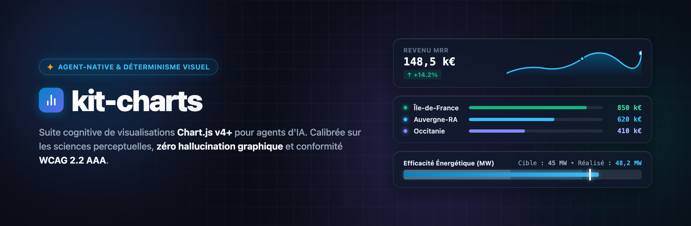

<p align="center">
  
</p>

# kit-charts

73 graphiques et tableaux prêts à l'emploi, pensés pour être compris du premier coup et lisibles par tous.

kit-charts sert surtout aux assistants IA (Claude Code, Cursor, Antigravity...). Au lieu d'inventer un graphique à chaque demande, l'assistant choisit un modèle éprouvé, y met vos données et vous rend une page que vous ouvrez dans votre navigateur.

---

## Pourquoi ce kit ?

Un graphique écrit à la volée par une IA tombe souvent dans les mêmes pièges :

- **Un axe qui ne part pas de zéro** : un écart de 2 % ressemble à un écart du simple au double.
- **Trop d'éléments** : 15 barres serrées ou 10 courbes emmêlées.
- **Des couleurs mal choisies** : illisibles pour les personnes daltoniennes, ou une hausse des coûts affichée en vert.
- **Un graphique qui n'est pas celui demandé** : un « diagramme de cordes » qui est en fait un radar.

kit-charts évite ces pièges. Chaque modèle a été vérifié à l'œil, en thème clair et en thème sombre, et des contrôles automatiques bloquent un graphique qui enfreint une règle de lisibilité.

---

## Démarrer

### 1. Récupérer le kit

```bash
git clone https://github.com/LouisLv-pro/kit-charts.git
cd kit-charts
```

Rien d'autre à installer pour voir les graphiques.

### 2. Parcourir la galerie

Ouvrez [`index.html`](index.html) dans votre navigateur (double-clic, ou `open index.html`).

- Elle fonctionne sans serveur, directement depuis le fichier.
- Changez de thème de couleurs en un clic : tous les graphiques suivent.
- Chaque carte s'ouvre en grand avec une explication : à quoi sert ce graphique, et quand l'éviter.

### 3. Demander un graphique à votre assistant IA

Décrivez simplement ce que vous voulez montrer :

```text
"Compare les ventes de chaque région à leur objectif de l'année, en thème sombre, avec les retards bien visibles."
```

L'assistant choisit le bon modèle (ici une jauge linéaire, `bullet-chart`), applique les bonnes couleurs et enregistre la page dans `output/ventes-regions/index.html`.

Il peut aussi :
- **réunir plusieurs graphiques sur une page**, pour un tableau de bord ou un rapport ;
- **les exporter en image (PNG, SVG) ou en PDF**, à coller dans une présentation ou un document ;
- **produire une page qui s'ouvre sans connexion internet**.

Pour mettre à jour un graphique avec les chiffres du mois, il suffit de redonner le fichier de données : le titre, les couleurs et le choix du modèle sont gardés.

### Utiliser le kit dans un autre projet

Installez la commande une seule fois :

```bash
npm i -g github:LouisLv-pro/kit-charts
```

Puis, dans le projet où vous voulez des graphiques, donnez le kit à votre assistant IA :

```bash
kit-charts install-skill
```

Les graphiques sont créés dans le dossier `output/` de ce projet.

---

## Comment l'assistant s'y prend

Un seul agent, `dataviz` ([`.agents/agents/dataviz.md`](.agents/agents/dataviz.md)), suit trois étapes décrites dans le skill [`kit-charts`](.agents/skills/kit-charts/SKILL.md) :

| Étape | Ce qu'il fait |
| :--- | :--- |
| **Comprendre** | Quel message faire passer ? Une hausse est-elle une bonne ou une mauvaise nouvelle ? |
| **Construire** | Choisit parmi les modèles adaptés à vos données, puis génère la page. Une configuration qui enfreint une règle est refusée. |
| **Vérifier** | Contrôles automatiques : contraste, axe à zéro, nombre d'éléments, unité présente, barres triées, titre qui énonce un constat. Puis relecture du sens. |

Tout se fait en une seule commande. L'assistant écrit les données dans un fichier (un tableau CSV suffit), puis lance `kit-charts make`. Sur les 9 cas d'essai du kit, ça coûte environ 80 % de moins à l'assistant qu'avant (en tokens, l'unité de facturation des IA) : 2 actions au lieu de 7 par graphique. La mesure se relance avec `npm run bench`.

---

## Les 73 modèles, rangés par question

| Vous voulez... | Exemples | La règle appliquée |
| :--- | :--- | :--- |
| **Afficher un chiffre clé** | `kpi-standard`, `kpi-sparkline`, `kpi-bullet` | Le chiffre en grand, avec la période à laquelle on le compare. |
| **Comparer des valeurs** | `bar-chart-vertical`, `bar-chart-horizontal`, `bullet-chart` | Les barres partent toujours de zéro. Au-delà de 7 éléments, on passe aux barres horizontales. |
| **Découper un total** | `doughnut-chart`, `stacked-bar-100`, `treemap` | Les parts font 100 %, peu de tranches, jamais de 3D. |
| **Voir comment se répartissent des valeurs** | `box-plot`, `histogramme`, `density-plot` | La médiane et les valeurs inhabituelles se voient tout de suite. |
| **Relier deux mesures** | `scatter-plot`, `bubble-chart`, `matrix-heatmap` | Pour les bulles, c'est la surface qui compte, pas le rayon. |
| **Suivre une évolution** | `line-chart`, `multi-line-chart`, `area-chart` | Le temps se lit de gauche à droite, 5 courbes au plus. |
| **Montrer des étapes ou des flux** | `funnel-chart`, `waterfall-chart`, `sankey-diagram` | Le taux de passage d'une étape à l'autre est affiché. |
| **Montrer une hiérarchie ou un réseau** | `sunburst`, `dendrogram`, `marimekko-chart` | Trois niveaux au plus, pour rester lisible. |
| **Placer des valeurs sur une carte** | `choropleth-map`, `bubble-map`, `cartogram-tilegram` | Des valeurs par habitant plutôt que des totaux, pour ne pas avantager les grands pays. |
| **Enrichir un tableau** | `table-kpi-scorecard`, `table-bar-in-cell` | Chiffres alignés à droite, petites barres et flèches dans les cellules. |

La galerie montre aussi une démonstration d'infobulles : au survol, une bulle donne le détail d'une valeur sans masquer les données voisines.

---

## 8 thèmes de couleurs

Tous restent lisibles par les personnes daltoniennes.

1. **`colorbrewer-accessible`** (par défaut) : clair et polyvalent.
2. **`viridis-perceptual`** : un dégradé régulier, qui reste lisible imprimé en noir et blanc.
3. **`paul-tol-scientific`** : pour bien distinguer plusieurs courbes.
4. **`tableau-stone-categorical`** : sobre, pour les rapports d'entreprise.
5. **`okabe-ito-cud`** : une palette conçue au départ pour les personnes daltoniennes.
6. **`tufte-minimalist-executive`** : noir, blanc et gris, une seule couleur pour l'essentiel.
7. **`nord-cognitive-dark`** : sombre et doux pour les yeux.
8. **`atkinson-hyperlegible`** : de forts contrastes pour les personnes malvoyantes.

### Le vert et le rouge ont un sens

Le kit choisit la couleur selon ce que mesure le chiffre :

- **Chiffre d'affaires, marge** : une hausse est verte, une baisse rouge.
- **Coûts, pannes, temps d'attente** : une hausse est rouge (mauvaise nouvelle), une baisse verte.
- **Objectif à tenir** : vert si atteint, orange en cas de léger retard, rouge en cas d'alerte.

---

## Pour les développeurs

### Commandes

```bash
# En un appel : données -> modèle -> page -> contrôles -> rendu -> export
kit-charts make ventes.csv --title "Lyon dépasse Paris" --subtitle "CA 2026, en k€" \
  --polarity HIGHER_IS_BETTER --export png,svg,pdf
kit-charts update output/lyon-depasse-paris --data ventes-novembre.csv   # refaire sans repartir de zéro
kit-charts compile output/bilan/page.json                                 # page à plusieurs graphiques
kit-charts export output/bilan/index.html --format png,svg,pdf
```

`--offline` inclut Chart.js dans la page, qui s'ouvre alors sans réseau. `kit-charts --help` liste toutes les options : colonnes du tableau, intention, thème.

Pas à pas, pour les cas que `make` ne couvre pas :

```bash
kit-charts list                                   # les 73 modèles
kit-charts recommend data.json                    # les modèles adaptés à vos données
kit-charts describe bar-chart-horizontal          # la forme des données attendue, avec un exemple
kit-charts init-spec bar-chart-horizontal -o output/mon-graphique/spec.json
kit-charts compile output/mon-graphique/spec.json -o output/mon-graphique/index.html
kit-charts validate output/mon-graphique/index.html
kit-charts check output/mon-graphique/index.html  # ouvre la page dans Chrome et vérifie qu'elle s'affiche
```

Dans ce dépôt, sans installation, remplacez `kit-charts` par `node bin/kit-charts.js`.

### Tests

```bash
npm run build        # régénère catalog-bundle.js à partir des modèles
npm test             # tests d'intégration, commande make, configurations de référence, mesure des tokens
npm run test:render  # affiche les 73 modèles dans Chrome (connexion internet requise)
npm run test:export  # export PNG, SVG et PDF dans Chrome (sans réseau)
npm run test:narrow  # lisibilité sur téléphone et tablette dans Chrome (sans réseau)
npm run test:cli     # installe le paquet et teste toutes les commandes
npm run bench        # compare le coût en tokens : pas à pas contre make
```

Après une modification volontaire d'un modèle, régénérez les configurations de référence avec `npm run snapshots` et relisez les différences avant de les valider. Les règles détaillées sont dans [`AGENTS.md`](AGENTS.md).

### Organisation du dépôt

```
kit-charts/
├── index.html              # La galerie
├── catalog-bundle.js       # Tous les modèles regroupés en un fichier (généré)
├── template/               # Les 73 modèles, un dossier chacun
│   ├── 00-kpi-card/        # Chiffres clés (7)
│   ├── 01-comparaison/     # Barres, jauges (11)
│   ├── 02-composition-part-to-whole/  # Parts d'un tout (8)
│   ├── 03-distribution/    # Répartition des valeurs (10)
│   ├── 04-correlation-relation/       # Liens entre mesures (7)
│   ├── 05-evolution-temporelle/       # Évolution dans le temps (10)
│   ├── 06-flux-processus/  # Flux et étapes (7)
│   ├── 07-hierarchie-reseau/          # Hiérarchies et réseaux (4)
│   ├── 08-geospatial-cartes/          # Cartes (3)
│   ├── 09-tableaux-dataviz/           # Tableaux enrichis (6)
│   └── tooltip/            # Démonstration d'infobulles
├── themes/                 # Les 8 thèmes et les réglages communs
├── vendor/                 # Chart.js et ses extensions, pour le mode hors ligne (versions et empreintes vérifiées)
├── docs/                   # Bannière et rapports de revue
├── output/                 # Vos graphiques générés
└── .agents/                # L'agent dataviz, ses règles et ses outils
```

Chaque modèle contient `template.js` (le dessin et un exemple de données), `schema.json` (la forme des données acceptée), `template.html` et une page `preview.html`.

---

## Contribuer

- **Proposer un modèle ou un thème** : suivez la structure d'un dossier existant et passez `npm test`.
- **Signaler un problème** : ouvrez une [issue GitHub](https://github.com/LouisLv-pro/kit-charts/issues) en décrivant ce que vous voyez.

---

## Licence

MIT : libre pour vos projets personnels, professionnels et vos assistants IA.
